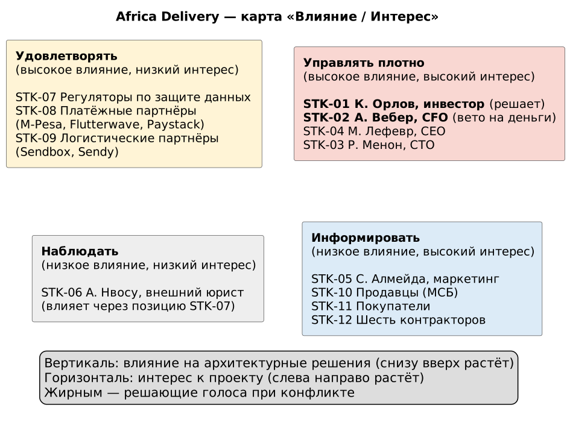

# Stakeholder Matrix — Africa Delivery

Источники: арт. 1–8 входных материалов; «Структура компании» и «Вводная» — описание участников и целей бизнеса. Противоречия (C-xx) — `contradictions.md`, вопросы (Q-xx) — `open-questions.md`.

## Чей голос решающий

| Область решения | Кто решает | Основание |
|---|---|---|
| Закон и данные | Регуляторы (STK-07), позиция доносится через юриста (STK-06). Не переговаривается | арт. 3; критерий успеха инвестора «не звонит министр» (арт. 1) |
| Дата, рынки, критерии успеха запуска | Орлов (STK-01) | Единственный акционер, «15 октября. Не обсуждается» (арт. 1) |
| Деньги и люди | Вебер (STK-02), право вето делегировано инвестором | «С Анной не спорь» (арт. 1); «неверна архитектура, а не бюджет» (арт. 6, п. 5) |
| Состав релиза и бизнес-модель | Лефевр (STK-04) | «Нужно чётко разделить, что входит в первый релиз» (арт. 1) |
| Технологии в рамках лимитов выше | Менон (STK-03) вместе с архитектором | «Технологии — твоя зона» (арт. 1) |

Правило эскалации: конфликт решается на уровне того, кто стоит выше в столбце «Приоритет». Технический спор CTO против бюджета CFO выигрывает CFO; спор о дате выигрывает инвестор. Том Брэдли (PM) стейкхолдером не является: он уволился, его список (арт. 4) остался входом без владельца.

## Матрица

| ID | Стейкхолдер | Интересы (что для него успех) | Влияние | Интерес | Приоритет при конфликте | Коммуникация |
|---|---|---|---|---|---|---|
| STK-07 | Регуляторы по защите данных Нигерии, Кении, ЮАР | Локализация ПДн, регистрация, DPO, подтверждаемые согласия (арт. 3, п. 1–3) | Высокое | Низкое | 1 | Через юриста; ранний контакт с регулятором Нигерии (арт. 3, п. 1) |
| STK-01 | К. Орлов, инвестор и единственный акционер | «Люди покупают. Продавцы получают деньги. Ничего не ломается», данные в стране, 40% рынка за 3 года (арт. 1, арт. 7) | Высокое | Высокое | 2 | Одна страница на английском, «решение, а не проблема», варианты в $ и минутах простоя; до четверга 13.08 (арт. 1) |
| STK-02 | А. Вебер, CFO | Компания жива на 7-м месяце: ≤$5 000/мес, без обязательств, ≤2,5% GMV на платежи, шесть контракторов (арт. 6) | Высокое | Высокое | 3 | Письменно, цифрами: стоимость заказа, TCO 5 лет, цена ошибки; КП и альтернатива по позициям >$500/мес (арт. 6, п. 2) |
| STK-04 | М. Лефевр, CEO | Чёткая граница первого релиза; опыт Jumia: запуск такого масштаба занимал год (арт. 1) | Высокое | Высокое | 4 | Таблица «в релизе / после релиза» с владельцем каждой функции |
| STK-03 | Р. Менон, CTO | Платформа не ложится в ночь запуска; cloud native, Go, без vendor lock-in, своя логистика (арт. 5) | Высокое | Высокое | 5 | Черновик ADR до встречи в Найроби (арт. 5); спор через измеримые критерии и PoC |
| STK-05 | С. Алмейда, Head of Marketing | Семь обещаний креативов выполнены, $180 000 медиа не сгорели (арт. 2) | Среднее | Высокое | 6 | Реестр обещаний со статусом «обеспечено платформой / процессом / не обеспечено» |
| STK-08 | Платёжные партнёры: M-Pesa, Flutterwave, Paystack | Договор, KYC бизнеса, оборот (Вводная, «Технологический стек») | Высокое | Низкое | 7 | Технический онбординг; оплата по счёту с отсрочкой 45 дней; если партнёр требует карту — отдельная закупка на 3 недели (арт. 6, п. 4) |
| STK-09 | Логистические партнёры: Sendbox (Нигерия), Sendy (Кения) | Объём отправлений через API (Вводная) | Среднее | Низкое | 7 | Договор и интеграция по API |
| STK-10 | Продавцы, малый и средний бизнес | Деньги на счёт сегодня (арт. 1); часть работает через WhatsApp и USSD (Вводная) | Низкое | Высокое | 8, голос через STK-04 | WhatsApp Business, SMS |
| STK-11 | Покупатели: городские со смартфонами, сельские с кнопочными телефонами | Доверие, скорость, экономия трафика (арт. 2) | Низкое | Высокое | 8, голос через STK-04 | Приложение, SMS, USSD |
| STK-12 | Шесть контракторов до декабря | Ясный скоуп, посильный стек (арт. 6, п. 5) | Низкое | Высокое | 9 | ADR в репозитории, ежедневная синхронизация |
| STK-06 | А. Нвосу, внешний юрист, Лагос | Предварительность выводов, ответственность не на бюро (арт. 3) | Низкое | Низкое | Своего приоритета нет; заключение — вход для STK-01 | Письменные вопросы узким списком: ставка почасовая («Структура компании») |

## Диаграмма «Влияние / Интерес»

Исходник: `stakeholder-influence-interest.puml`.

## Assumptions

- A-09. Во встрече в Найроби участвуют STK-01–STK-05; юрист и партнёры в ней не участвуют.
- A-11. Совет директоров, на который ссылается CTO (арт. 5), действует в интересах единственного акционера и отдельным стейкхолдером не выделяется.
