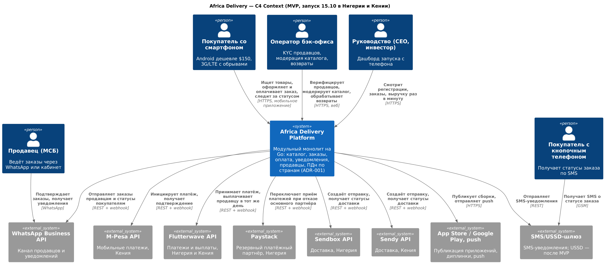

# Architecture Vision — Africa Delivery

**Версия:** 1.0 · **Дата:** 18.08.2026 · **Решение:** [ADR-001](adr-001-architecture-style.md)

## 1. Введение

**Цель документа.** Связать бизнес-цели запуска 15.10 с архитектурой, которую можно построить шестью людьми за $5 000/мес, и зафиксировать, какие решения отложены и до какого триггера.

**Область.** Маркетплейс в Нигерии и Кении на запуске (ЮАР — следующая, A-08): мобильное приложение покупателя, канал продавца через WhatsApp, бэк-офис, интеграции с платёжными и логистическими партнёрами. Собственные склад, логистика и платёжная лицензия в область не входят.

**Глоссарий.** *Страновая ячейка* — изолированное хранилище ПДн в стране субъекта. *Критический путь* — «каталог → заказ → оплата». *Late binding* — решение, отложенное до измеримого триггера.

## 2. Бизнес-контекст и цели

| ID | Цель | Метрика | Источник |
|---|---|---|---|
| G-01 | Люди покупают, продавцы получают деньги, данные не покидают страну | Первая оплаченная и выплаченная сделка 15.10 | арт. 1, арт. 7 |
| G-02 | MVP: 5 000 SKU, 100 продавцов, M-Pesa и Flutterwave, SMS и мессенджеры, кабинет, аналитика CEO | Все сценарии UC-01…UC-14 работают | Вводная |
| G-03 | Приложения в сторах к 01.10 | Опубликовано, диплинки ведут на карточку | арт. 2 |
| G-04 | Компания жива на 7-м месяце | Облако + SaaS ≤ $5 000/мес, 6 человек | арт. 6 |
| G-05 | Через 12 месяцев: 5 стран, 1 млн+ пользователей, B2B — без переписывания ядра | Новая страна — конфигурация и партнёры | Вводная |

**Кто решает.** Инвестор (STK-01) — дата и критерии успеха; CFO (STK-02) — деньги и люди, право вето делегировано инвестором; CEO (STK-04) — состав релиза; CTO (STK-03) — технологии в этих рамках; регуляторы — закон ([stakeholder-matrix.md](../task1/stakeholder-matrix.md)).

**Стратегические драйверы.** Неподвижная дата и оплаченная реклама (D-01), жёсткий бюджет (D-02), доступность критического пути (D-03), резидентность данных (D-04), слабая сеть и дешёвые устройства (D-05), тиражируемость на 15 стран (D-06).

## 3. Текущее состояние

Систем нет, разработка с нуля (Вводная, «Технологический стек»). Болевые точки — во входных требованиях, а не в ИТ: десять противоречий между артефактами, четыре из которых физически невыполнимы одновременно ([contradictions.md](../task1/contradictions.md)). Главное: 99,99% под 10 млн против $5 000/мес; 40–50 сервисов против шести человек; прямые платежи против отсутствия лицензии; данные в Нигерии против площадок без нигерийского региона.

## 4. Целевое состояние

Исходник: [c4-context.puml](c4-context.puml). Сценарии MVP — [use-cases.png](use-cases.png).

| Компонент | Ответственность | Граница |
|---|---|---|
| Модуль каталога | Товары, поиск, карточки, фото под 3G | Только чтение для других модулей; отдаётся из CDN-кеша при отказе ядра |
| Модуль заказа | Корзина, заказ, статусы, возвраты | Единственный владелец заказа |
| Модуль оплаты | Маршрутизация между партнёрами, учёт, выплаты продавцам в день подтверждения получения | Деньги не хранит, работает через лицензированных партнёров |
| Модуль уведомлений | SMS, WhatsApp, push, учёт согласий | Рассылки только по opt-in |
| Модуль продавцов | Онбординг, KYC через оператора, заказы через WhatsApp | |
| Модуль ПДн | Имена, телефоны, адреса | Физически в страновой ячейке; наружу — только маскированные данные |
| Бэк-офис и дашборд | Модерация, возвраты, метрики запуска раз в минуту | |

**Интеграции.** Все внешние вызовы асинхронны через outbox: заказ подтверждается покупателю, даже если SMS-шлюз или логистика временно недоступны. Платежи — M-Pesa и Flutterwave, Paystack — резерв на переключение. Доставка — Sendbox (Нигерия), Sendy (Кения).

## 5. Принципы и ограничения

| ID | Принцип | Следствие |
|---|---|---|
| P-01 | Buy/Partner по умолчанию, Build — только ядро маркетплейса | Логистика и платежи — партнёры (CN-06, CN-08) |
| P-02 | Открытые движки на managed-сервисах | PostgreSQL и Kubernetes без лицензий; выход от провайдера — через IaC и контейнеры (CN-05) |
| P-03 | Доступность покупается по экономике | Следующая «девятка» включается, когда стоимость простоя превышает стоимость резерва |
| P-04 | Данные живут в стране субъекта | Страновые ячейки, маскирование на выходе (CN-07) |
| P-05 | Модуль сегодня — сервис завтра | Модули не делят таблицы, общаются через интерфейсы и события |
| P-06 | Одна кодовая база, один язык | Go для всего бэкенда (арт. 5) |

**Ограничения.** $5 000/мес на всё техническое, позиция >$500 — с согласованием CFO, без годовых обязательств, оплата по счёту с отсрочкой 45 дней (арт. 6, п. 1–4). Шесть контракторов (п. 5). Приём платежей ≤2,5% GMV (п. 6).

**Стандарты.** Go, PostgreSQL, OpenTelemetry, GitOps, архитектурные тесты границ модулей в CI.

## 6. Нефункциональные требования

| ID | Требование | Цель Года 1 | Приоритет |
|---|---|---|---|
| NFR-01 | Доступность критического пути | 99,9% (≈44 мин/мес); с 7-го месяца 99,95%; с Года 3 99,99% | 1 |
| NFR-02 | Резидентность ПДн | 100% ПДн Нигерии и Кении — в стране | 1 |
| NFR-03 | Производительность | Меньше 2 с до первого товара на 3G (арт. 2) | 2 |
| NFR-04 | Пиковая нагрузка | 50 тыс. одновременных сессий в неделю запуска (A-01) | 2 |
| NFR-05 | Стоимость | ИТ на заказ ≤ $0,70 к 12-му месяцу (модель: $0,62) | 2 |
| NFR-06 | Потеря данных | RPO ≤ 5 мин (реплика в другой зоне + журнал), RTO ≤ 1 ч | 3 |
| NFR-07 | Безопасность | Аутентификация по номеру телефона и OTP, шифрование ПДн, учёт согласий | 1 |

При конфликте сначала соблюдаются закон (NFR-02, NFR-07), затем доступность критического пути, затем скорость и стоимость. Детализация — в задании 3.

## 7. Дорожная карта

| Этап | Сроки | Результат |
|---|---|---|
| Фундамент | 24.08–06.09 | Каркас монолита, CI/CD, страновые ячейки, договоры с партнёрами |
| MVP | 07.09–30.09 | UC-01…UC-14, публикация в сторах к 01.10 |
| Стабилизация | 01.10–14.10 | Нагрузочный тест 50 тыс. сессий, учения по отказу партнёра |
| Запуск | 15.10 | Нигерия и Кения |
| Наращивание | Месяцы 7–12 | Warm standby (LB-01), ЮАР, кабинет продавца, track & trace, возвраты |
| Масштаб | Год 2–3 | Выделение сервисов (LB-02), Kafka (LB-03), второй регион, 5 → 15 стран |

**Отложенные решения** (LB-01…LB-08, [ADR-001](adr-001-architecture-style.md)): второй регион, выделение сервисов, Kafka, сервисная сетка, мульти-облако, своя логистика, окончательная модель ПДн, блокчейн-лояльность. Блокчейн-лояльность (арт. 1, арт. 5) — исследование после MVP: в первом релизе её нет.

## 8. Риски и допущения

| ID | Риск | Мера |
|---|---|---|
| R-01 | Пик запуска и стрима 17.10 выше ёмкости | Нагрузочный тест до 08.10, каталог из CDN |
| R-02 | Заключение юриста меняет модель хранения | Строгая трактовка, ПДн за интерфейсом модуля |
| R-03 | Платёжный партнёр не подключён к 01.10 | Договор до 28.08, Paystack в резерве |
| R-07 | Рост опережает план | Переделка монолита оценена в $180 000 (A-17) |
| R-08 | Год 1 при 99,9% — до 44 мин простоя в месяц | Деградация до каталога из кеша, warm standby с 7-го месяца |

## Assumptions

- A-01. Пик первой недели — 50 тыс. одновременных сессий, годовой масштаб — 1 млн пользователей.
- A-03. До заключения юриста все ПДн субъекта хранятся в стране субъекта.
- A-05. Разработка 24.08–30.09, стабилизация 01–14.10.
- A-07. Логистика и платежи — партнёрские в первый год.
- A-08. ЮАР в пилот 15.10 не входит.
- A-12 — A-18 — см. [options-comparison.md](options-comparison.md#assumptions).
