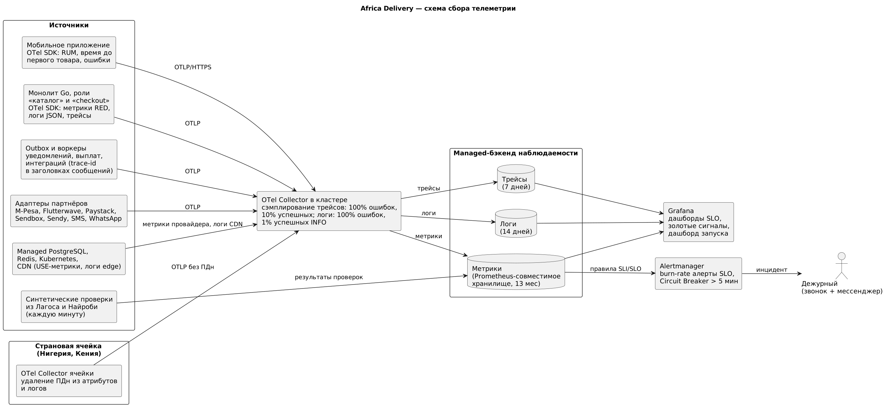

# Стратегия наблюдаемости — Africa Delivery

Источники: арт. 1 («я не хочу слышать „оно лежит“»), арт. 5 (OpenTelemetry, Prometheus, Grafana), [ADR-001](../task2/adr-001-architecture-style.md) (CTO-04: стандарт OpenTelemetry, managed-бэкенд), [nfr-registry.md](nfr-registry.md), [slo/](slo/).

Задача — чтобы дежурный за 2 минуты понял, есть ли инцидент, и за 15 минут нашёл, где он. Метрики сигналят, трейсы показывают, где застрял запрос, логи объясняют причину. Графики строятся только по метрикам. В логи идут после того, как график показал проблему.

## Схема сбора

Исходник: [observability-pipeline.puml](observability-pipeline.puml).

- **Модель сбора.** Метрики собираются по pull: OTel Collector опрашивает `/metrics` подов каждые 15 с. Короткие задачи (cron-сверка, выплаты) отправляют метрики по push через OTLP.
- **Резидентность данных.** Collector страновой ячейки удаляет ПДн из атрибутов и логов до того, как телеметрия покидает страну (NFR-02). Телефон и адрес в логах заменены на хеш.
- **Контекст трейса.** Trace-id передаётся через заголовки HTTP и в метаданных сообщений outbox, иначе цепочка «заказ → оплата → уведомление» рвётся на асинхронной границе. Webhook партнёров связываются с трейсом по ID транзакции.

## Четыре золотых сигнала по сервисам

Для модулей (пользовательская логика) — метод RED, для ресурсов (БД, Redis, очереди, ячейки) — метод USE.

| Сервис | Задержка (Latency) | Трафик (Traffic) | Ошибки (Errors) | Насыщение (Saturation) |
|---|---|---|---|---|
| Каталог | `http_server_request_duration_seconds{module="catalog"}` p50/p99; RUM `app_first_product_seconds` p75 | RPS на edge и origin; `cdn_cache_hit_ratio` | Доля 5xx на edge и origin | Пул соединений к реплике чтения; CPU подов роли «каталог»; память Redis |
| Оплата | `payment_attempt_duration_seconds` по партнёру; `payment_confirm_lag_seconds` | `payment_attempts_total` по партнёру и стране | `payment_attempts_total{outcome="technical_error"}`; `circuit_breaker_state` | Пул соединений к основной БД; очередь опроса статусов; очередь выплат |
| Уведомления | `notification_dispatch_seconds` по каналу | Событий outbox в секунду; отправок по каналу | Отказы шлюза; `notifications_lost_total` | Длина очередей (транзакционной и маркетинговой); возраст старейшего события outbox |
| Заказ / checkout | `http_server_request_duration_seconds{module="order"}` p99 | Заказов в минуту | 5xx; `stock_reservation_conflicts_total` | Блокировки строк остатков; пул БД роли «checkout» |
| Инфраструктура (USE) | Задержка репликации PostgreSQL | IOPS, сетевой трафик | Ошибки дисков и узлов | CPU, память, диск БД; узлы Kubernetes |

## Связь метрик с SLI

| SLI | Формула из метрик | Где задан |
|---|---|---|
| SLI-CAT-01 | Ответы CDN 2xx/304/404 / все ответы каталога | [slo/catalog.md](slo/catalog.md) |
| SLI-CAT-02 | Бакет `le="0.8"` гистограммы задержки каталога / все запросы origin | [slo/catalog.md](slo/catalog.md) |
| SLI-CAT-03 | `app_first_product_seconds` ≤ 2 с / все запуски на 3G | [slo/catalog.md](slo/catalog.md) |
| SLI-PAY-01 | `payment_attempts_total{outcome=~"success\|declined"}` / все попытки | [slo/payments.md](slo/payments.md) |
| SLI-PAY-02 | `payment_confirm_lag_seconds` ≤ 30 с / все успешные у партнёра | [slo/payments.md](slo/payments.md) |
| SLI-PAY-04 | `seller_payouts_total{same_day="true"}` / все выплаты | [slo/payments.md](slo/payments.md) |
| SLI-NTF-01 | `notification_dispatch_seconds{class="transactional"}` ≤ 60 с / все транзакционные | [slo/notifications.md](slo/notifications.md) |

Метрики железа (CPU, RAM) в SLI не входят: пользователь их не видит. Они нужны для поиска причины.

## Логи и трейсы

| | Правило |
|---|---|
| Формат логов | JSON: `timestamp`, `level`, `module`, `trace_id`, `order_id`, `country`, `event`. ПДн запрещены (проверка линтером в CI) |
| Сэмплирование логов | 100% WARN и ERROR, 1% успешных INFO; журнал платежей и выплат — 100% (это аудит, не отладка) |
| Хранение | Логи 14 дней, трейсы 7 дней, метрики 13 месяцев (сравнение год к году) |
| Трейсы | OpenTelemetry. Tail-сэмплирование в Collector: 100% трейсов с ошибкой или длиннее p99, 10% остальных |
| Кардинальность метрик | Метки — модуль, маршрут, страна, партнёр, код ответа. ID пользователя и заказа в метках запрещены: только в логах и трейсах |

## Алерты и что считается инцидентом

Алерты строятся по скорости расхода бюджета ошибок (multi-window burn rate), а не по порогам CPU:

| Условие | Действие |
|---|---|
| Расход бюджета SLO в 14,4 раза выше нормы за 1 ч и за 5 мин | Звонок дежурному: инцидент SEV-1 |
| Расход в 6 раз выше нормы за 6 ч и за 30 мин | Сообщение дежурному: инцидент SEV-2 |
| Circuit Breaker партнёра открыт дольше 5 мин | SEV-2, эскалация партнёру по договору |
| Страновая ячейка ПДн недоступна дольше 2 мин | SEV-1 |
| Расхождение в сверке платежей > 0 | SEV-2 команде оплаты в рабочее время |
| Маркетинговое сообщение без согласия | SEV-1, остановка рассылок |
| Доля попаданий в CDN < 90% 15 мин | Тикет: деградация кеша (ADR-002) |

Всё остальное — не инцидент, а сигнал на дашборде.

## Инструменты

| Слой | Инструмент | Почему |
|---|---|---|
| Инструментирование | OpenTelemetry SDK (Go, Android, iOS) | Открытый стандарт, без привязки к бэкенду (CTO-04) |
| Сбор и обработка | OpenTelemetry Collector в кластере и в каждой ячейке | Сэмплирование, удаление ПДн, маршрутизация |
| Метрики, логи, трейсы | Managed Grafana-стек: Prometheus-совместимые метрики, Loki, Tempo | Тот же стек, что просит CTO (арт. 5), без собственной эксплуатации; укладывается в строку $2 400/год блока 2 TCO |
| Синтетика | Проверки критического пути из Лагоса и Найроби раз в минуту | Видеть то, что видит покупатель на местной сети |
| Алерты | Alertmanager → звонок и мессенджер дежурного | Burn-rate правила по SLO |
| Дашборд запуска | Grafana: регистрации, заказы, выручка, обновление раз в минуту, мобильная вёрстка | Требование арт. 2 |

Переход на self-hosted стек — при выходе за $500/мес на наблюдаемость (порог согласования CFO, арт. 6, п. 2) или по требованию регулятора к месту хранения телеметрии.
