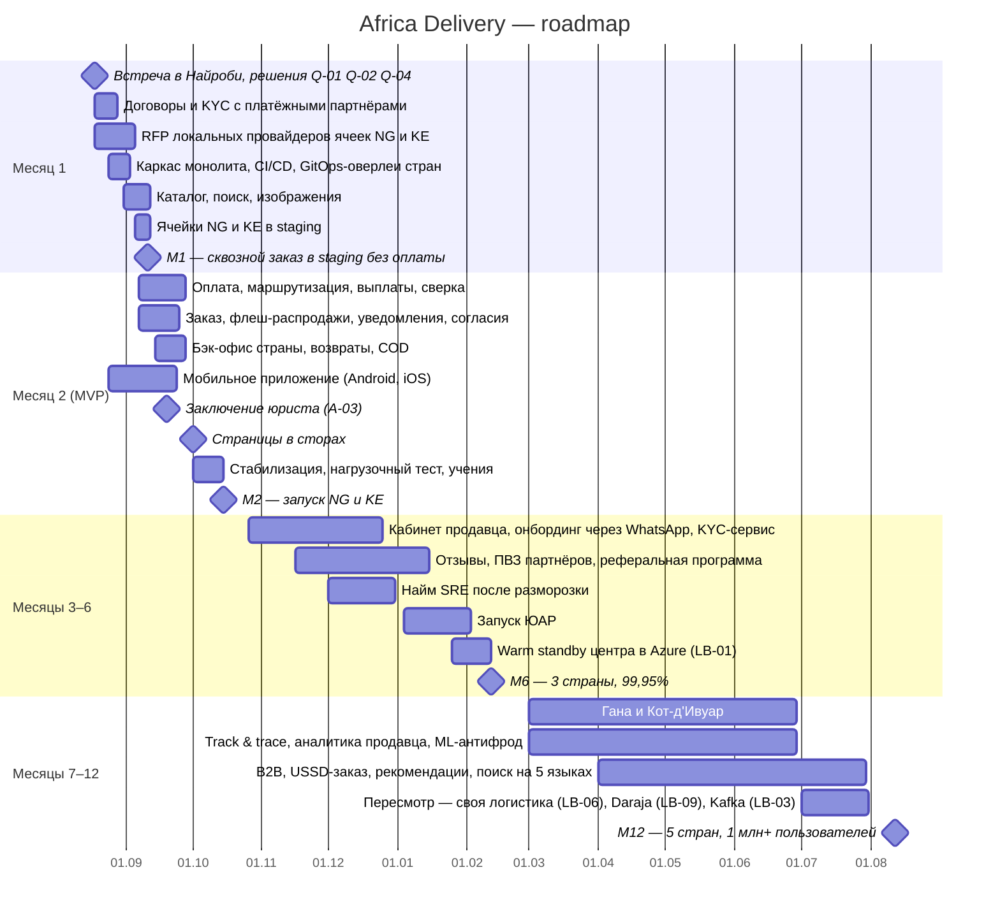

# Roadmap — Africa Delivery

Источники: арт. 1, 2, 4, 6, «Вводная» («Цели бизнеса»), [capability-map.md](capability-map.md), [tco-model.xlsx](../task2/tco-model.xlsx), [ADR-001…003](../task2/adr-001-architecture-style.md), [ADR-004](adr-004-payment-provider.md). Риски — [risk-register.md](risk-register.md), команда — [team-structure.md](team-structure.md).

Отсчёт — от старта проекта 12.08.2026. Контрольные точки: **M1** — 11.09.2026, **M2 (MVP)** — 15.10.2026, **M6** — 12.02.2027, **M12** — 12.08.2027.

Отрендеренная версия: [roadmap.png](roadmap.png).

## Контрольные точки

| Точка | Scope | Команда | Облако и SaaS |
|---|---|---|---|
| **M1 (11.09)** | Договоры с Flutterwave и Paystack, выбраны провайдеры ячеек; монолит, CI/CD, ячейки в staging; каталог и поиск; сквозной заказ без оплаты | 6 контракторов: 4 Go, 1 мобильный, 1 DevOps | ≈$1 500/мес (staging) |
| **M2 — MVP (15.10)** | 9 функций из 29 списка PM (таблица ниже), в Нигерии и Кении; SLO 99,9% | Те же 6 | **$4 530/мес** из $5 000 (ADR-003) |
| **M6 (12.02)** | +6 функций; запуск ЮАР; warm standby — 99,95%; KYC-сервис | 7: найм SRE после разморозки в декабре (арт. 6, п. 5) | ≈$6 200/мес: + warm standby $1 050, ячейка ZA ≈$400. Требует согласования CFO: потолок $5 000 действует первые полгода |
| **M12 (12.08.2027)** | +6 функций; Гана и Кот-д'Ивуар — 5 стран; решения по LB-03, LB-06, LB-09 | 9: 7 разработчиков, 2 SRE (TCO_A, Год 2) | ≈$12 100/мес: уровень TCO_A Года 2 ($10 700) + 2 ячейки ($1 400) |

## Что сделали со списком PM (29 функций)

**Критерий отбора в MVP** — функция входит, только если выполнены все три условия:
- **K1.** Она на критическом пути «купить → оплатить → доставить → выплатить» (арт. 1) или это публичное обещание креативов (арт. 2), которое процесс не закроет.
- **K2.** Укладывается в ёмкость 22 чел.-нед. бэкенда (A-31).
- **K3.** Не требует лицензии или заключения юриста.

Функции, не вошедшие в MVP, распределены по целям бизнеса на 6 и 12 месяцев (Вводная). Лицензионные — отклонены.

| Период | Функции (номер по арт. 4) | Сколько |
|---|---|---|
| **MVP, M2** | 1 каталог (фиксированный набор категорий и атрибутов) · 2 поиск (английский, опечатки через триграммы) · 11 оплата (M-Pesa, карты, переводы, COD в Лагосе и Найроби) · 16 флеш-распродажи · 18 отслеживание (статусы партнёров, без карты и ETA) · 20 возвраты (обработка оператором, деньги при приёме возврата) · 25 приложение (одно кроссплатформенное, без PWA) · 26 бэк-офис (KYC, модерация, возвраты) · 28 дашборд руководства | **9, из них 7 в урезанном виде** |
| **M6** | 7 отзывы с фото · 8 онбординг продавца через WhatsApp · 10 кабинет продавца (без когорт и прогноза) · 19 ПВЗ партнёров (без видеофиксации) · 23 реферальная программа · 29 тёмная тема | 6 |
| **M12** | 4 рекомендации · 6 чат покупателя с продавцом · 9 онбординг продавца через USSD · 21 ML-антифрод · 22 B2B · 24 заказ через USSD и SMS | 6 |
| **После 12 месяцев, по данным** | 3 голосовой поиск · 5 покупка внутри live-стрима (в MVP стримы идут на внешних платформах с диплинками на карточки) · 14 крипто-лояльность (исследование, LB-08) · 15 «Колесо фортуны» · 17 динамическое ценообразование по парсингу Jumia (правовой риск) · 27 публичный GraphQL API | 6 |
| **Отклонено** | 12 рассрочка со своим скорингом — нужна кредитная лицензия · 13 кошелёк с переводами между пользователями — нужна лицензия на электронные деньги | 2 |

Обещания креативов, которые MVP закрывает процессом, а не кодом:
- **Live-стримы 17.10** — на внешних платформах, с диплинками на карточки товаров.
- **«Покупай на своём языке»** — интерфейс приложения на 5 языках, каталог — на английском.
- **«Доставка день в день»** — обязательство в договорах с Sendbox и Sendy.
- **«Миллион покупателей в первый месяц»** — требованием к сайзингу не является, нагрузочный ориентир — 50 тыс. одновременных сессий (A-01).

## Готовность к встрече в Найроби

Мы готовы предложить решение, но не можем обещать результат без трёх ответов.

**Что гарантирует план к 15.10:**
- покупатель в Нигерии и Кении находит товар, платит M-Pesa, картой, переводом или наличными в Лагосе и Найроби;
- продавец получает заказ в WhatsApp и выплату в день подтверждения получения;
- данные остаются в стране;
- облако укладывается в $4 530/мес.

**Что под риском и как это заметим:**
- **Срок MVP.** Ёмкость бэкенда занята полностью (RR-01). Если к 08.09 сделано меньше 40% объёма, режем по заранее согласованному порядку: COD, затем флеш-распродажи (остаются простые скидки), затем возвраты в приложении (остаются через поддержку).
- **Подключение платежей.** Договоры с партнёрами нужны до 28.08 (RR-02).
- **Публикация в App Store.** Ревью Apple может задержать её после 01.10 (RR-05).

**Без каких решений план не стартует 24.08:**
- **Инвестор:** подтверждение 99,9% в Году 1 (Q-01).
- **CFO:** входят ли SMS в $5 000 (Q-02).
- **CEO:** кто финансирует мгновенный возврат (Q-04).

Без ответов действуют допущения из `../task1/open-questions.md`, и последствия называются на встрече.

## Assumptions

- A-01. Нагрузочный ориентир — 50 тыс. одновременных сессий.
- A-31. Ёмкость бэкенда — 22 чел.-нед. до стабилизации.
- A-35. Наём заморожен до декабря (арт. 6, п. 5); с декабря CFO разрешает найм по модели TCO_A.
- A-36. Страны 4 и 5 — Гана и Кот-д'Ивуар: обе покрыты Paystack, Кот-д'Ивуар закрывает обещание интерфейса на французском. Окончательный выбор — на M6.
